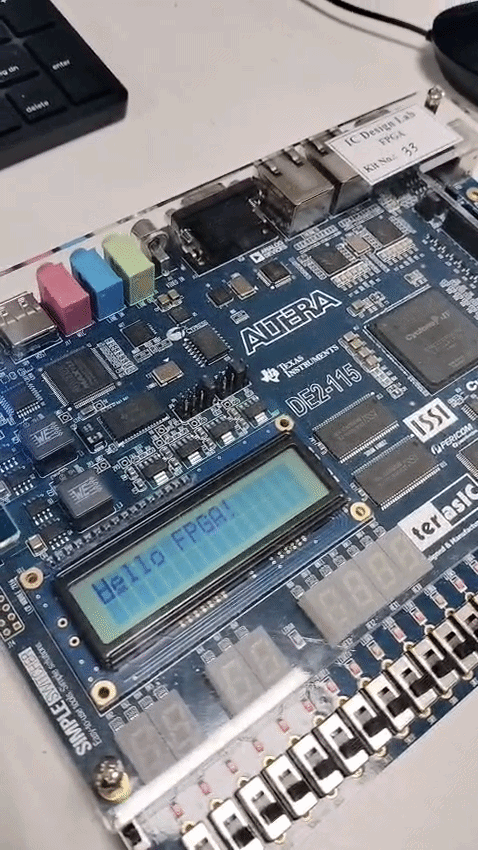

# Winter 25-26 - FPGA Lab Files Archive 

## Summary
- `.v` files: 102
- `.mpf` files: 15
- `.qpf` files: 25
- Verilog files with modules: 96

## .v files
- [01_Basic_Digital_Logic/button/button_toggle.v](01_Basic_Digital_Logic/button/button_toggle.v)
- [01_Basic_Digital_Logic/button_7se/button_counter_seg.v](01_Basic_Digital_Logic/button_7se/button_counter_seg.v)
- [01_Basic_Digital_Logic/buttoncheck/buttonchek.v](01_Basic_Digital_Logic/buttoncheck/buttonchek.v)
- [01_Basic_Digital_Logic/clock/clock.v](01_Basic_Digital_Logic/clock/clock.v)
- [01_Basic_Digital_Logic/counter_sevenseg/seven_seg_counter.v](01_Basic_Digital_Logic/counter_sevenseg/seven_seg_counter.v)
- [01_Basic_Digital_Logic/counter_sevenseg4/sevenseg4_3bitcounter.v](01_Basic_Digital_Logic/counter_sevenseg4/sevenseg4_3bitcounter.v)
- [01_Basic_Digital_Logic/seq_multiplier.v](01_Basic_Digital_Logic/seq_multiplier.v)
- [02_Finite_State_Machines/fsm/fsm.v](02_Finite_State_Machines/fsm/fsm.v)
- [02_Finite_State_Machines/fsm_moore/moore_vending_machine.v](02_Finite_State_Machines/fsm_moore/moore_vending_machine.v)
- [02_Finite_State_Machines/moore_fsm_da/moore_vending_machine.v](02_Finite_State_Machines/moore_fsm_da/moore_vending_machine.v)
- [02_Finite_State_Machines/moore_fsm_da/output_files/buttoncheck.v](02_Finite_State_Machines/moore_fsm_da/output_files/buttoncheck.v)
- [03_Display_Interfaces/lcd_counter_display/lcd_counter_display.v](03_Display_Interfaces/lcd_counter_display/lcd_counter_display.v)
- [03_Display_Interfaces/lcd_display.v](03_Display_Interfaces/lcd_display.v)
- [/05_Additional_Experiments//04_Signal_Processing//FIR_FILTER/Counter_up.v](/05_Additional_Experiments//04_Signal_Processing//FIR_FILTER/Counter_up.v)
- [/05_Additional_Experiments//04_Signal_Processing//FIR_FILTER/debounce.v](/05_Additional_Experiments//04_Signal_Processing//FIR_FILTER/debounce.v)
- [/05_Additional_Experiments//04_Signal_Processing//FIR_FILTER/down.v](/05_Additional_Experiments//04_Signal_Processing//FIR_FILTER/down.v)
- [/05_Additional_Experiments//04_Signal_Processing//FIR_FILTER/fir_filter.v](/05_Additional_Experiments//04_Signal_Processing//FIR_FILTER/fir_filter.v)
- [/05_Additional_Experiments//04_Signal_Processing//FIR_SERIAL_4TAP/fir_filter.v](/05_Additional_Experiments//04_Signal_Processing//FIR_SERIAL_4TAP/fir_filter.v)
- [/05_Additional_Experiments//04_Signal_Processing//SOBEL_eDGE_3/dff.v](/05_Additional_Experiments//04_Signal_Processing//SOBEL_eDGE_3/dff.v)
- [/05_Additional_Experiments//04_Signal_Processing//SOBEL_eDGE_3/dff_tb.v](/05_Additional_Experiments//04_Signal_Processing//SOBEL_eDGE_3/dff_tb.v)
- [/05_Additional_Experiments//04_Signal_Processing//SOBEL_eDGE_3/jkff.v](/05_Additional_Experiments//04_Signal_Processing//SOBEL_eDGE_3/jkff.v)
- [/05_Additional_Experiments//04_Signal_Processing//SOBEL_eDGE_3/jkff_tb.v](/05_Additional_Experiments//04_Signal_Processing//SOBEL_eDGE_3/jkff_tb.v)
- [/05_Additional_Experiments//04_Signal_Processing//SOBEL_eDGE_3/jkfff_tb.v](/05_Additional_Experiments//04_Signal_Processing//SOBEL_eDGE_3/jkfff_tb.v)
- [/05_Additional_Experiments//04_Signal_Processing//SOBEL_eDGE_3/pipo.v](/05_Additional_Experiments//04_Signal_Processing//SOBEL_eDGE_3/pipo.v)
- [/05_Additional_Experiments//04_Signal_Processing//SOBEL_eDGE_3/pipo_tb.v](/05_Additional_Experiments//04_Signal_Processing//SOBEL_eDGE_3/pipo_tb.v)
- [/05_Additional_Experiments//04_Signal_Processing//SOBEL_eDGE_3/piso.v](/05_Additional_Experiments//04_Signal_Processing//SOBEL_eDGE_3/piso.v)
- [/05_Additional_Experiments//04_Signal_Processing//SOBEL_eDGE_3/piso_tb.v](/05_Additional_Experiments//04_Signal_Processing//SOBEL_eDGE_3/piso_tb.v)
- [/05_Additional_Experiments//04_Signal_Processing//SOBEL_eDGE_3/pisojtb.v](/05_Additional_Experiments//04_Signal_Processing//SOBEL_eDGE_3/pisojtb.v)
- [/05_Additional_Experiments//04_Signal_Processing//SOBEL_eDGE_3/pisojtb_tb.v](/05_Additional_Experiments//04_Signal_Processing//SOBEL_eDGE_3/pisojtb_tb.v)
- [/05_Additional_Experiments//04_Signal_Processing//SOBEL_eDGE_3/sipo.v](/05_Additional_Experiments//04_Signal_Processing//SOBEL_eDGE_3/sipo.v)
- [/05_Additional_Experiments//04_Signal_Processing//SOBEL_eDGE_3/sipo_tb.v](/05_Additional_Experiments//04_Signal_Processing//SOBEL_eDGE_3/sipo_tb.v)
- [/05_Additional_Experiments//04_Signal_Processing//SOBEL_eDGE_3/sipoo_tb.v](/05_Additional_Experiments//04_Signal_Processing//SOBEL_eDGE_3/sipoo_tb.v)
- [/05_Additional_Experiments//04_Signal_Processing//SOBEL_eDGE_3/siso.v](/05_Additional_Experiments//04_Signal_Processing//SOBEL_eDGE_3/siso.v)
- [/05_Additional_Experiments//04_Signal_Processing//SOBEL_eDGE_3/siso_tb.v](/05_Additional_Experiments//04_Signal_Processing//SOBEL_eDGE_3/siso_tb.v)
- [/05_Additional_Experiments//04_Signal_Processing//SOBEL_eDGE_3/sisojtb.v](/05_Additional_Experiments//04_Signal_Processing//SOBEL_eDGE_3/sisojtb.v)
- [/05_Additional_Experiments//04_Signal_Processing//SOBEL_eDGE_3/sisojtb_tb.v](/05_Additional_Experiments//04_Signal_Processing//SOBEL_eDGE_3/sisojtb_tb.v)
- [/05_Additional_Experiments//04_Signal_Processing//SOBEL_eDGE_3/sobel_filter.v](/05_Additional_Experiments//04_Signal_Processing//SOBEL_eDGE_3/sobel_filter.v)
- [/05_Additional_Experiments//04_Signal_Processing//SOBEL_eDGE_3/srff.v](/05_Additional_Experiments//04_Signal_Processing//SOBEL_eDGE_3/srff.v)
- [/05_Additional_Experiments//04_Signal_Processing//SOBEL_eDGE_3/srff_tb.v](/05_Additional_Experiments//04_Signal_Processing//SOBEL_eDGE_3/srff_tb.v)
- [/05_Additional_Experiments//04_Signal_Processing//SOBEL_eDGE_3/tff.v](/05_Additional_Experiments//04_Signal_Processing//SOBEL_eDGE_3/tff.v)
- [/05_Additional_Experiments//04_Signal_Processing//SOBEL_eDGE_3/tff_tb.v](/05_Additional_Experiments//04_Signal_Processing//SOBEL_eDGE_3/tff_tb.v)
- [/04_Memory_And_Resources//dp_ram_ip.v](/04_Memory_And_Resources//dp_ram_ip.v)
- [/04_Memory_And_Resources//dp_ram_ip/dp_ram_ip.v](/04_Memory_And_Resources//dp_ram_ip/dp_ram_ip.v)
- [/04_Memory_And_Resources//dp_ram_ip/dp_ram_ip_bb.v](/04_Memory_And_Resources//dp_ram_ip/dp_ram_ip_bb.v)
- [/04_Memory_And_Resources//dp_ram_ip/dp_ram_ip_inst.v](/04_Memory_And_Resources//dp_ram_ip/dp_ram_ip_inst.v)
- [/04_Memory_And_Resources//dp_ram_ip_bb.v](/04_Memory_And_Resources//dp_ram_ip_bb.v)
- [/04_Memory_And_Resources//dp_ram_ip_inst.v](/04_Memory_And_Resources//dp_ram_ip_inst.v)
- [/04_Memory_And_Resources//dpram/dpram.v](/04_Memory_And_Resources//dpram/dpram.v)
- [/04_Memory_And_Resources//dpram/dpram_tb.v](/04_Memory_And_Resources//dpram/dpram_tb.v)
- [/04_Memory_And_Resources//SPRAM/dpram.v](/04_Memory_And_Resources//SPRAM/dpram.v)
- [/04_Memory_And_Resources//SPRAM/spram.v](/04_Memory_And_Resources//SPRAM/spram.v)
- [/04_Memory_And_Resources//SPRAM/spram_tb.v](/04_Memory_And_Resources//SPRAM/spram_tb.v)
- [/04_Memory_And_Resources//tb_dp_ram_ip.v](/04_Memory_And_Resources//tb_dp_ram_ip.v)
- [/05_Additional_Experiments//clock/clock_23BEC0137.v](/05_Additional_Experiments//clock/clock_23BEC0137.v)
- [/05_Additional_Experiments//filehandling/file.v](/05_Additional_Experiments//filehandling/file.v)
- [/05_Additional_Experiments//hi/button_toggle.v](/05_Additional_Experiments//hi/button_toggle.v)
- [/05_Additional_Experiments//pratice_rtl/fifo.v](/05_Additional_Experiments//pratice_rtl/fifo.v)
- [/05_Additional_Experiments//pratice_rtl/fifo_bb.v](/05_Additional_Experiments//pratice_rtl/fifo_bb.v)
- [/05_Additional_Experiments//pratice_rtl/fifo_inst.v](/05_Additional_Experiments//pratice_rtl/fifo_inst.v)
- [/05_Additional_Experiments//pratice_rtl/fifo_syn.v](/05_Additional_Experiments//pratice_rtl/fifo_syn.v)
- [/05_Additional_Experiments//pratice_rtl/SEQ_MUL.v](/05_Additional_Experiments//pratice_rtl/SEQ_MUL.v)
- [/05_Additional_Experiments//pratice_rtl/seq_multiplier.v](/05_Additional_Experiments//pratice_rtl/seq_multiplier.v)
- [/05_Additional_Experiments//pratice_rtl/tb_fifo.v](/05_Additional_Experiments//pratice_rtl/tb_fifo.v)
- [/05_Additional_Experiments//pratice_rtl/top.v](/05_Additional_Experiments//pratice_rtl/top.v)
- [/05_Additional_Experiments//QUARYTUSPINASSIGNER/pin_assigner_v1/test.v](/05_Additional_Experiments//QUARYTUSPINASSIGNER/pin_assigner_v1/test.v)
- [/05_Additional_Experiments//REVIEW1/top_128bit_display_ADDROUNDDKEY/addRoundKey.v](/05_Additional_Experiments//REVIEW1/top_128bit_display_ADDROUNDDKEY/addRoundKey.v)
- [/05_Additional_Experiments//REVIEW1/top_128bit_display_ADDROUNDDKEY/rom_128_1.v](/05_Additional_Experiments//REVIEW1/top_128bit_display_ADDROUNDDKEY/rom_128_1.v)
- [/05_Additional_Experiments//REVIEW1/top_128bit_display_ADDROUNDDKEY/rom128.v](/05_Additional_Experiments//REVIEW1/top_128bit_display_ADDROUNDDKEY/rom128.v)
- [/05_Additional_Experiments//REVIEW1/top_128bit_display_ADDROUNDDKEY/top_128bit_display.v](/05_Additional_Experiments//REVIEW1/top_128bit_display_ADDROUNDDKEY/top_128bit_display.v)
- [/05_Additional_Experiments//REVIEW1/top_128bit_display_ADDROUNDDKEY/top_module.v](/05_Additional_Experiments//REVIEW1/top_128bit_display_ADDROUNDDKEY/top_module.v)
- [/05_Additional_Experiments//REVIEW1/top_128bit_display_SUB_BYTGES/rom128.v](/05_Additional_Experiments//REVIEW1/top_128bit_display_SUB_BYTGES/rom128.v)
- [/05_Additional_Experiments//REVIEW1/top_128bit_display_SUB_BYTGES/sbox.v](/05_Additional_Experiments//REVIEW1/top_128bit_display_SUB_BYTGES/sbox.v)
- [/05_Additional_Experiments//REVIEW1/top_128bit_display_SUB_BYTGES/subBytes.v](/05_Additional_Experiments//REVIEW1/top_128bit_display_SUB_BYTGES/subBytes.v)
- [/05_Additional_Experiments//REVIEW1/top_128bit_display_SUB_BYTGES/top_128bit_display.v](/05_Additional_Experiments//REVIEW1/top_128bit_display_SUB_BYTGES/top_128bit_display.v)
- [/05_Additional_Experiments//REVIEW1/top_128bit_display_SUB_BYTGES/top_module.v](/05_Additional_Experiments//REVIEW1/top_128bit_display_SUB_BYTGES/top_module.v)
- [/07_Assignments_And_Reviews//FINAL_REVIEW/aes_pipeline_top.v](/07_Assignments_And_Reviews//FINAL_REVIEW/aes_pipeline_top.v)
- [/07_Assignments_And_Reviews//FINAL_REVIEW/aes_top.v](/07_Assignments_And_Reviews//FINAL_REVIEW/aes_top.v)
- [/07_Assignments_And_Reviews//FINAL_REVIEW/io-final/aes_core.v](/07_Assignments_And_Reviews//FINAL_REVIEW/io-final/aes_core.v)
- [/07_Assignments_And_Reviews//FINAL_REVIEW/io-final/counter2_up.v](/07_Assignments_And_Reviews//FINAL_REVIEW/io-final/counter2_up.v)
- [/07_Assignments_And_Reviews//FINAL_REVIEW/io-final/debounce.v](/07_Assignments_And_Reviews//FINAL_REVIEW/io-final/debounce.v)
- [/07_Assignments_And_Reviews//FINAL_REVIEW/io-final/edge_detector.v](/07_Assignments_And_Reviews//FINAL_REVIEW/io-final/edge_detector.v)
- [/07_Assignments_And_Reviews//FINAL_REVIEW/io-final/eight_sevenseg_32bit.v](/07_Assignments_And_Reviews//FINAL_REVIEW/io-final/eight_sevenseg_32bit.v)
- [/07_Assignments_And_Reviews//FINAL_REVIEW/io-final/hex_to_7seg.v](/07_Assignments_And_Reviews//FINAL_REVIEW/io-final/hex_to_7seg.v)
- [/07_Assignments_And_Reviews//FINAL_REVIEW/io-final/io-final/aes_core.v](/07_Assignments_And_Reviews//FINAL_REVIEW/io-final/io-final/aes_core.v)
- [/07_Assignments_And_Reviews//FINAL_REVIEW/io-final/io-final/counter2_up.v](/07_Assignments_And_Reviews//FINAL_REVIEW/io-final/io-final/counter2_up.v)
- [/07_Assignments_And_Reviews//FINAL_REVIEW/io-final/io-final/debounce.v](/07_Assignments_And_Reviews//FINAL_REVIEW/io-final/io-final/debounce.v)
- [/07_Assignments_And_Reviews//FINAL_REVIEW/io-final/io-final/edge_detector.v](/07_Assignments_And_Reviews//FINAL_REVIEW/io-final/io-final/edge_detector.v)
- [/07_Assignments_And_Reviews//FINAL_REVIEW/io-final/io-final/eight_sevenseg_32bit.v](/07_Assignments_And_Reviews//FINAL_REVIEW/io-final/io-final/eight_sevenseg_32bit.v)
- [/07_Assignments_And_Reviews//FINAL_REVIEW/io-final/io-final/hex_to_7seg.v](/07_Assignments_And_Reviews//FINAL_REVIEW/io-final/io-final/hex_to_7seg.v)
- [/07_Assignments_And_Reviews//FINAL_REVIEW/io-final/io-final/key_rom128.v](/07_Assignments_And_Reviews//FINAL_REVIEW/io-final/io-final/key_rom128.v)
- [/07_Assignments_And_Reviews//FINAL_REVIEW/io-final/io-final/mux4x1_32bit.v](/07_Assignments_And_Reviews//FINAL_REVIEW/io-final/io-final/mux4x1_32bit.v)
- [/07_Assignments_And_Reviews//FINAL_REVIEW/io-final/io-final/rom128.v](/07_Assignments_And_Reviews//FINAL_REVIEW/io-final/io-final/rom128.v)
- [/07_Assignments_And_Reviews//FINAL_REVIEW/io-final/io-final/top.v](/07_Assignments_And_Reviews//FINAL_REVIEW/io-final/io-final/top.v)
- [/07_Assignments_And_Reviews//FINAL_REVIEW/io-final/io-final/top_128bit_display.v](/07_Assignments_And_Reviews//FINAL_REVIEW/io-final/io-final/top_128bit_display.v)
- [/07_Assignments_And_Reviews//FINAL_REVIEW/io-final/key_rom128.v](/07_Assignments_And_Reviews//FINAL_REVIEW/io-final/key_rom128.v)
- [/07_Assignments_And_Reviews//FINAL_REVIEW/io-final/mux4x1_32bit.v](/07_Assignments_And_Reviews//FINAL_REVIEW/io-final/mux4x1_32bit.v)
- [/07_Assignments_And_Reviews//FINAL_REVIEW/io-final/rom128.v](/07_Assignments_And_Reviews//FINAL_REVIEW/io-final/rom128.v)
- [/07_Assignments_And_Reviews//FINAL_REVIEW/io-final/top.v](/07_Assignments_And_Reviews//FINAL_REVIEW/io-final/top.v)
- [/07_Assignments_And_Reviews//FINAL_REVIEW/io-final/top_128bit_display.v](/07_Assignments_And_Reviews//FINAL_REVIEW/io-final/top_128bit_display.v)
- [ip/spram_ip.v](ip/spram_ip.v)
- [ip/spram_ip_bb.v](ip/spram_ip_bb.v)
- [ip/spram_ip_inst.v](ip/spram_ip_inst.v)

## .mpf files
- [01_Basic_Digital_Logic/seq_multiplier.mpf](01_Basic_Digital_Logic/seq_multiplier.mpf)
- [02_Finite_State_Machines/fsm/mealy.mpf](02_Finite_State_Machines/fsm/mealy.mpf)
- [03_Display_Interfaces/lcd_display.mpf](03_Display_Interfaces/lcd_display.mpf)
- [/05_Additional_Experiments//04_Signal_Processing//FIR_FILTER/Counter.mpf](/05_Additional_Experiments//04_Signal_Processing//FIR_FILTER/Counter.mpf)
- [/05_Additional_Experiments//04_Signal_Processing//FIR_FILTER/fir_filter.mpf](/05_Additional_Experiments//04_Signal_Processing//FIR_FILTER/fir_filter.mpf)
- [/05_Additional_Experiments//04_Signal_Processing//FIR_FILTER/fir_filter'.mpf](/05_Additional_Experiments//04_Signal_Processing//FIR_FILTER/fir_filter'.mpf)
- [/05_Additional_Experiments//04_Signal_Processing//SOBEL_eDGE_3/sobel_edge.mpf](/05_Additional_Experiments//04_Signal_Processing//SOBEL_eDGE_3/sobel_edge.mpf)
- [/04_Memory_And_Resources//dp_ram_ip.mpf](/04_Memory_And_Resources//dp_ram_ip.mpf)
- [/04_Memory_And_Resources//dpram/dpram.mpf](/04_Memory_And_Resources//dpram/dpram.mpf)
- [/04_Memory_And_Resources//SPRAM/spram.mpf](/04_Memory_And_Resources//SPRAM/spram.mpf)
- [/05_Additional_Experiments//filehandling/file.mpf](/05_Additional_Experiments//filehandling/file.mpf)
- [/05_Additional_Experiments//hi/hi.mpf](/05_Additional_Experiments//hi/hi.mpf)
- [/05_Additional_Experiments//pratice_rtl/fifo.mpf](/05_Additional_Experiments//pratice_rtl/fifo.mpf)
- [/05_Additional_Experiments//pratice_rtl/SEQ_MUL.mpf](/05_Additional_Experiments//pratice_rtl/SEQ_MUL.mpf)
- [/05_Additional_Experiments//pratice_rtl/top.mpf](/05_Additional_Experiments//pratice_rtl/top.mpf)

## .qpf files
- [01_Basic_Digital_Logic/button/button_toggle.qpf](01_Basic_Digital_Logic/button/button_toggle.qpf)
- [01_Basic_Digital_Logic/button_7se/button_counter_seg.qpf](01_Basic_Digital_Logic/button_7se/button_counter_seg.qpf)
- [01_Basic_Digital_Logic/buttoncheck/buttonchek.qpf](01_Basic_Digital_Logic/buttoncheck/buttonchek.qpf)
- [01_Basic_Digital_Logic/clock/clock.qpf](01_Basic_Digital_Logic/clock/clock.qpf)
- [01_Basic_Digital_Logic/counter_sevenseg/seven_seg_counter.qpf](01_Basic_Digital_Logic/counter_sevenseg/seven_seg_counter.qpf)
- [01_Basic_Digital_Logic/counter_sevenseg4/sevenseg4_3bitcounter.qpf](01_Basic_Digital_Logic/counter_sevenseg4/sevenseg4_3bitcounter.qpf)
- [01_Basic_Digital_Logic/seq/seq_multiplier.qpf](01_Basic_Digital_Logic/seq/seq_multiplier.qpf)
- [02_Finite_State_Machines/fsm/fsm.qpf](02_Finite_State_Machines/fsm/fsm.qpf)
- [02_Finite_State_Machines/moore_fsm_da/moore_vending_machine.qpf](02_Finite_State_Machines/moore_fsm_da/moore_vending_machine.qpf)
- [03_Display_Interfaces/lcd.qpf](03_Display_Interfaces/lcd.qpf)
- [03_Display_Interfaces/lcd_counter_display/lcd_counter_display.qpf](03_Display_Interfaces/lcd_counter_display/lcd_counter_display.qpf)
- [/05_Additional_Experiments//04_Signal_Processing//FIR_FILTER/fir_filter.qpf](/05_Additional_Experiments//04_Signal_Processing//FIR_FILTER/fir_filter.qpf)
- [/05_Additional_Experiments//04_Signal_Processing//FIR_SERIAL_4TAP/fir_filter.qpf](/05_Additional_Experiments//04_Signal_Processing//FIR_SERIAL_4TAP/fir_filter.qpf)
- [/04_Memory_And_Resources//dp_ram_ip.qpf](/04_Memory_And_Resources//dp_ram_ip.qpf)
- [/04_Memory_And_Resources//dp_ram_ip/dp_ram_ip.qpf](/04_Memory_And_Resources//dp_ram_ip/dp_ram_ip.qpf)
- [/04_Memory_And_Resources//dpram/dpram_ip.qpf](/04_Memory_And_Resources//dpram/dpram_ip.qpf)
- [/04_Memory_And_Resources//memory/spram.qpf](/04_Memory_And_Resources//memory/spram.qpf)
- [/05_Additional_Experiments//clock/clock_23BEC0137.qpf](/05_Additional_Experiments//clock/clock_23BEC0137.qpf)
- [/05_Additional_Experiments//da3/dp_ram.qpf](/05_Additional_Experiments//da3/dp_ram.qpf)
- [/05_Additional_Experiments//pratice_rtl/top.qpf](/05_Additional_Experiments//pratice_rtl/top.qpf)
- [/05_Additional_Experiments//REVIEW1/top_128bit_display_ADDROUNDDKEY/top_module.qpf](/05_Additional_Experiments//REVIEW1/top_128bit_display_ADDROUNDDKEY/top_module.qpf)
- [/05_Additional_Experiments//REVIEW1/top_128bit_display_SUB_BYTGES/top_module.qpf](/05_Additional_Experiments//REVIEW1/top_128bit_display_SUB_BYTGES/top_module.qpf)
- [/07_Assignments_And_Reviews//FINAL_REVIEW/io-final/io-final/top.qpf](/07_Assignments_And_Reviews//FINAL_REVIEW/io-final/io-final/top.qpf)
- [/07_Assignments_And_Reviews//FINAL_REVIEW/io-final/top.qpf](/07_Assignments_And_Reviews//FINAL_REVIEW/io-final/top.qpf)
- [ip/spram_ip.qpf](ip/spram_ip.qpf)

## Modules by Verilog file
- [01_Basic_Digital_Logic/button/button_toggle.v](01_Basic_Digital_Logic/button/button_toggle.v)
  - button_toggle
- [01_Basic_Digital_Logic/button_7se/button_counter_seg.v](01_Basic_Digital_Logic/button_7se/button_counter_seg.v)
  - button_counter_seg
- [01_Basic_Digital_Logic/buttoncheck/buttonchek.v](01_Basic_Digital_Logic/buttoncheck/buttonchek.v)
  - buttonchek
- [01_Basic_Digital_Logic/clock/clock.v](01_Basic_Digital_Logic/clock/clock.v)
  - clock
  - clk_div
  - segment7
- [01_Basic_Digital_Logic/counter_sevenseg/seven_seg_counter.v](01_Basic_Digital_Logic/counter_sevenseg/seven_seg_counter.v)
  - seven_seg_counter
  - clk_div
  - counter
  - segment7
- [01_Basic_Digital_Logic/counter_sevenseg4/sevenseg4_3bitcounter.v](01_Basic_Digital_Logic/counter_sevenseg4/sevenseg4_3bitcounter.v)
  - sevenseg4_3bitcounter
  - clk_div
  - counter
  - segment7
- [01_Basic_Digital_Logic/seq_multiplier.v](01_Basic_Digital_Logic/seq_multiplier.v)
  - seq_multiplier
  - seq_mul
  - seq_multiplier_vlg_vec_tst
- [02_Finite_State_Machines/fsm/fsm.v](02_Finite_State_Machines/fsm/fsm.v)
  - fsm
- [02_Finite_State_Machines/fsm_moore/moore_vending_machine.v](02_Finite_State_Machines/fsm_moore/moore_vending_machine.v)
  - moore_vending_machine
- [02_Finite_State_Machines/moore_fsm_da/moore_vending_machine.v](02_Finite_State_Machines/moore_fsm_da/moore_vending_machine.v)
  - moore_vending_machine
- [02_Finite_State_Machines/moore_fsm_da/output_files/buttoncheck.v](02_Finite_State_Machines/moore_fsm_da/output_files/buttoncheck.v)
  - buttoncheck
- [03_Display_Interfaces/lcd_counter_display/lcd_counter_display.v](03_Display_Interfaces/lcd_counter_display/lcd_counter_display.v)
  - lcd_counter_display
- [03_Display_Interfaces/lcd_display.v](03_Display_Interfaces/lcd_display.v)
  - lcd_display
- [/05_Additional_Experiments//04_Signal_Processing//FIR_FILTER/Counter_up.v](/05_Additional_Experiments//04_Signal_Processing//FIR_FILTER/Counter_up.v)
  - counter_up
  - tb_counter
- [/05_Additional_Experiments//04_Signal_Processing//FIR_FILTER/debounce.v](/05_Additional_Experiments//04_Signal_Processing//FIR_FILTER/debounce.v)
  - debounce
- [/05_Additional_Experiments//04_Signal_Processing//FIR_FILTER/down.v](/05_Additional_Experiments//04_Signal_Processing//FIR_FILTER/down.v)
  - counter_down
  - tb_counter_down
- [/05_Additional_Experiments//04_Signal_Processing//FIR_FILTER/fir_filter.v](/05_Additional_Experiments//04_Signal_Processing//FIR_FILTER/fir_filter.v)
  - fir_filter
- [/05_Additional_Experiments//04_Signal_Processing//FIR_SERIAL_4TAP/fir_filter.v](/05_Additional_Experiments//04_Signal_Processing//FIR_SERIAL_4TAP/fir_filter.v)
  - fir_filter
- [/05_Additional_Experiments//04_Signal_Processing//SOBEL_eDGE_3/dff.v](/05_Additional_Experiments//04_Signal_Processing//SOBEL_eDGE_3/dff.v)
  - dff
- [/05_Additional_Experiments//04_Signal_Processing//SOBEL_eDGE_3/dff_tb.v](/05_Additional_Experiments//04_Signal_Processing//SOBEL_eDGE_3/dff_tb.v)
  - dff_tb
- [/05_Additional_Experiments//04_Signal_Processing//SOBEL_eDGE_3/jkff.v](/05_Additional_Experiments//04_Signal_Processing//SOBEL_eDGE_3/jkff.v)
  - jkff
- [/05_Additional_Experiments//04_Signal_Processing//SOBEL_eDGE_3/jkff_tb.v](/05_Additional_Experiments//04_Signal_Processing//SOBEL_eDGE_3/jkff_tb.v)
  - jkff_tb
- [/05_Additional_Experiments//04_Signal_Processing//SOBEL_eDGE_3/jkfff_tb.v](/05_Additional_Experiments//04_Signal_Processing//SOBEL_eDGE_3/jkfff_tb.v)
  - jkfff_tb
- [/05_Additional_Experiments//04_Signal_Processing//SOBEL_eDGE_3/pipo.v](/05_Additional_Experiments//04_Signal_Processing//SOBEL_eDGE_3/pipo.v)
  - pipo
- [/05_Additional_Experiments//04_Signal_Processing//SOBEL_eDGE_3/pipo_tb.v](/05_Additional_Experiments//04_Signal_Processing//SOBEL_eDGE_3/pipo_tb.v)
  - pipo_tb
- [/05_Additional_Experiments//04_Signal_Processing//SOBEL_eDGE_3/piso.v](/05_Additional_Experiments//04_Signal_Processing//SOBEL_eDGE_3/piso.v)
  - piso
- [/05_Additional_Experiments//04_Signal_Processing//SOBEL_eDGE_3/piso_tb.v](/05_Additional_Experiments//04_Signal_Processing//SOBEL_eDGE_3/piso_tb.v)
  - piso_tb
- [/05_Additional_Experiments//04_Signal_Processing//SOBEL_eDGE_3/pisojtb.v](/05_Additional_Experiments//04_Signal_Processing//SOBEL_eDGE_3/pisojtb.v)
  - pisojtb
- [/05_Additional_Experiments//04_Signal_Processing//SOBEL_eDGE_3/pisojtb_tb.v](/05_Additional_Experiments//04_Signal_Processing//SOBEL_eDGE_3/pisojtb_tb.v)
  - pisojtb_tb
- [/05_Additional_Experiments//04_Signal_Processing//SOBEL_eDGE_3/sipo.v](/05_Additional_Experiments//04_Signal_Processing//SOBEL_eDGE_3/sipo.v)
  - sipo
- [/05_Additional_Experiments//04_Signal_Processing//SOBEL_eDGE_3/siso.v](/05_Additional_Experiments//04_Signal_Processing//SOBEL_eDGE_3/siso.v)
  - siso
- [/05_Additional_Experiments//04_Signal_Processing//SOBEL_eDGE_3/siso_tb.v](/05_Additional_Experiments//04_Signal_Processing//SOBEL_eDGE_3/siso_tb.v)
  - siso_tb
- [/05_Additional_Experiments//04_Signal_Processing//SOBEL_eDGE_3/sisojtb.v](/05_Additional_Experiments//04_Signal_Processing//SOBEL_eDGE_3/sisojtb.v)
  - sisojtb
- [/05_Additional_Experiments//04_Signal_Processing//SOBEL_eDGE_3/sisojtb_tb.v](/05_Additional_Experiments//04_Signal_Processing//SOBEL_eDGE_3/sisojtb_tb.v)
  - sisojtb_tb
- [/05_Additional_Experiments//04_Signal_Processing//SOBEL_eDGE_3/sobel_filter.v](/05_Additional_Experiments//04_Signal_Processing//SOBEL_eDGE_3/sobel_filter.v)
  - sobel_edge_detection
  - tb_sobel_edge_detection
- [/05_Additional_Experiments//04_Signal_Processing//SOBEL_eDGE_3/srff.v](/05_Additional_Experiments//04_Signal_Processing//SOBEL_eDGE_3/srff.v)
  - srff
- [/05_Additional_Experiments//04_Signal_Processing//SOBEL_eDGE_3/srff_tb.v](/05_Additional_Experiments//04_Signal_Processing//SOBEL_eDGE_3/srff_tb.v)
  - srff_tb
- [/05_Additional_Experiments//04_Signal_Processing//SOBEL_eDGE_3/tff.v](/05_Additional_Experiments//04_Signal_Processing//SOBEL_eDGE_3/tff.v)
  - tff
- [/05_Additional_Experiments//04_Signal_Processing//SOBEL_eDGE_3/tff_tb.v](/05_Additional_Experiments//04_Signal_Processing//SOBEL_eDGE_3/tff_tb.v)
  - tb_tff
- [/04_Memory_And_Resources//dp_ram_ip.v](/04_Memory_And_Resources//dp_ram_ip.v)
  - dp_ram_ip
- [/04_Memory_And_Resources//dp_ram_ip/dp_ram_ip.v](/04_Memory_And_Resources//dp_ram_ip/dp_ram_ip.v)
  - dp_ram_ip
- [/04_Memory_And_Resources//dp_ram_ip/dp_ram_ip_bb.v](/04_Memory_And_Resources//dp_ram_ip/dp_ram_ip_bb.v)
  - dp_ram_ip
- [/04_Memory_And_Resources//dp_ram_ip_bb.v](/04_Memory_And_Resources//dp_ram_ip_bb.v)
  - dp_ram_ip
- [/04_Memory_And_Resources//dpram/dpram.v](/04_Memory_And_Resources//dpram/dpram.v)
  - dpram
- [/04_Memory_And_Resources//dpram/dpram_tb.v](/04_Memory_And_Resources//dpram/dpram_tb.v)
  - dpram_tb
- [/04_Memory_And_Resources//SPRAM/dpram.v](/04_Memory_And_Resources//SPRAM/dpram.v)
  - dpram
  - spram_tb
- [/04_Memory_And_Resources//SPRAM/spram.v](/04_Memory_And_Resources//SPRAM/spram.v)
  - spram
- [/04_Memory_And_Resources//SPRAM/spram_tb.v](/04_Memory_And_Resources//SPRAM/spram_tb.v)
  - spram_tb
- [/04_Memory_And_Resources//tb_dp_ram_ip.v](/04_Memory_And_Resources//tb_dp_ram_ip.v)
  - tb_dpram
- [/05_Additional_Experiments//clock/clock_23BEC0137.v](/05_Additional_Experiments//clock/clock_23BEC0137.v)
  - clock_23BEC0137
  - segment7
- [/05_Additional_Experiments//filehandling/file.v](/05_Additional_Experiments//filehandling/file.v)
  - file
  - tb_read
  - tb_copy
- [/05_Additional_Experiments//hi/button_toggle.v](/05_Additional_Experiments//hi/button_toggle.v)
  - button_toggle
- [/05_Additional_Experiments//pratice_rtl/fifo.v](/05_Additional_Experiments//pratice_rtl/fifo.v)
  - fifo
- [/05_Additional_Experiments//pratice_rtl/fifo_bb.v](/05_Additional_Experiments//pratice_rtl/fifo_bb.v)
  - fifo
- [/05_Additional_Experiments//pratice_rtl/fifo_syn.v](/05_Additional_Experiments//pratice_rtl/fifo_syn.v)
  - fifo_cntr
  - fifo_a_fefifo
  - fifo_altsyncram
  - fifo_cntr1
  - fifo_a_dpfifo
  - fifo_scfifo
  - fifo
- [/05_Additional_Experiments//pratice_rtl/SEQ_MUL.v](/05_Additional_Experiments//pratice_rtl/SEQ_MUL.v)
  - SEQ_MUL
  - tb_SEQ_MUL
- [/05_Additional_Experiments//pratice_rtl/seq_multiplier.v](/05_Additional_Experiments//pratice_rtl/seq_multiplier.v)
  - SEQ_MUL
  - tb_SEQ_MUL
- [/05_Additional_Experiments//pratice_rtl/tb_fifo.v](/05_Additional_Experiments//pratice_rtl/tb_fifo.v)
  - tb_fifo
- [/05_Additional_Experiments//pratice_rtl/top.v](/05_Additional_Experiments//pratice_rtl/top.v)
  - decoder_2x4
  - d_ff_pr
  - d_ff_clr
  - ring_counter_4bit
  - top
  - aes_fsm
  - aes_datapath
  - aes_keyschedule
  - aes_mixcolumns
  - aes_shiftrows
  - aes_subbytes
  - aes_sbox
  - cla_cgu
- [/05_Additional_Experiments//QUARYTUSPINASSIGNER/pin_assigner_v1/test.v](/05_Additional_Experiments//QUARYTUSPINASSIGNER/pin_assigner_v1/test.v)
  - Ha
- [/05_Additional_Experiments//REVIEW1/top_128bit_display_ADDROUNDDKEY/addRoundKey.v](/05_Additional_Experiments//REVIEW1/top_128bit_display_ADDROUNDDKEY/addRoundKey.v)
  - addRoundKey
- [/05_Additional_Experiments//REVIEW1/top_128bit_display_ADDROUNDDKEY/rom_128_1.v](/05_Additional_Experiments//REVIEW1/top_128bit_display_ADDROUNDDKEY/rom_128_1.v)
  - rom128_1
- [/05_Additional_Experiments//REVIEW1/top_128bit_display_ADDROUNDDKEY/rom128.v](/05_Additional_Experiments//REVIEW1/top_128bit_display_ADDROUNDDKEY/rom128.v)
  - rom128
- [/05_Additional_Experiments//REVIEW1/top_128bit_display_ADDROUNDDKEY/top_128bit_display.v](/05_Additional_Experiments//REVIEW1/top_128bit_display_ADDROUNDDKEY/top_128bit_display.v)
  - debounce
  - mux4x1_32bit
  - hex_to_7seg
  - eight_sevenseg_32bit
  - edge_detector
  - counter2_up
  - top_128bit_display
- [/05_Additional_Experiments//REVIEW1/top_128bit_display_ADDROUNDDKEY/top_module.v](/05_Additional_Experiments//REVIEW1/top_128bit_display_ADDROUNDDKEY/top_module.v)
  - top_module
- [/05_Additional_Experiments//REVIEW1/top_128bit_display_SUB_BYTGES/rom128.v](/05_Additional_Experiments//REVIEW1/top_128bit_display_SUB_BYTGES/rom128.v)
  - rom128
- [/05_Additional_Experiments//REVIEW1/top_128bit_display_SUB_BYTGES/sbox.v](/05_Additional_Experiments//REVIEW1/top_128bit_display_SUB_BYTGES/sbox.v)
  - sbox
- [/05_Additional_Experiments//REVIEW1/top_128bit_display_SUB_BYTGES/subBytes.v](/05_Additional_Experiments//REVIEW1/top_128bit_display_SUB_BYTGES/subBytes.v)
  - subBytes
- [/05_Additional_Experiments//REVIEW1/top_128bit_display_SUB_BYTGES/top_128bit_display.v](/05_Additional_Experiments//REVIEW1/top_128bit_display_SUB_BYTGES/top_128bit_display.v)
  - debounce
  - mux4x1_32bit
  - hex_to_7seg
  - eight_sevenseg_32bit
  - edge_detector
  - counter2_up
  - top_128bit_display
- [/05_Additional_Experiments//REVIEW1/top_128bit_display_SUB_BYTGES/top_module.v](/05_Additional_Experiments//REVIEW1/top_128bit_display_SUB_BYTGES/top_module.v)
  - top_module
- [/07_Assignments_And_Reviews//FINAL_REVIEW/aes_pipeline_top.v](/07_Assignments_And_Reviews//FINAL_REVIEW/aes_pipeline_top.v)
  - aes_pipeline_top
  - aes_subbytes
  - aes_shiftrows
  - aes_sbox
  - aes_mixcolumns
  - aes_keyschedule
- [/07_Assignments_And_Reviews//FINAL_REVIEW/aes_top.v](/07_Assignments_And_Reviews//FINAL_REVIEW/aes_top.v)
  - aes_top
  - aes_fsm
  - aes_datapath
  - aes_keyschedule
  - aes_mixcolumns
  - aes_shiftrows
  - aes_subbytes
  - aes_sbox
- [/07_Assignments_And_Reviews//FINAL_REVIEW/io-final/aes_core.v](/07_Assignments_And_Reviews//FINAL_REVIEW/io-final/aes_core.v)
  - aes_core
  - aes_subbytes
  - aes_shiftrows
  - aes_sbox
  - aes_mixcolumns
  - aes_keyschedule
- [/07_Assignments_And_Reviews//FINAL_REVIEW/io-final/counter2_up.v](/07_Assignments_And_Reviews//FINAL_REVIEW/io-final/counter2_up.v)
  - counter2_up
- [/07_Assignments_And_Reviews//FINAL_REVIEW/io-final/debounce.v](/07_Assignments_And_Reviews//FINAL_REVIEW/io-final/debounce.v)
  - debounce
- [/07_Assignments_And_Reviews//FINAL_REVIEW/io-final/edge_detector.v](/07_Assignments_And_Reviews//FINAL_REVIEW/io-final/edge_detector.v)
  - edge_detector
- [/07_Assignments_And_Reviews//FINAL_REVIEW/io-final/eight_sevenseg_32bit.v](/07_Assignments_And_Reviews//FINAL_REVIEW/io-final/eight_sevenseg_32bit.v)
  - eight_sevenseg_32bit
- [/07_Assignments_And_Reviews//FINAL_REVIEW/io-final/hex_to_7seg.v](/07_Assignments_And_Reviews//FINAL_REVIEW/io-final/hex_to_7seg.v)
  - hex_to_7seg
- [/07_Assignments_And_Reviews//FINAL_REVIEW/io-final/io-final/aes_core.v](/07_Assignments_And_Reviews//FINAL_REVIEW/io-final/io-final/aes_core.v)
  - aes_core
  - aes_fsm
  - aes_datapath
  - aes_keyschedule
  - aes_mixcolumns
  - aes_shiftrows
  - aes_subbytes
  - aes_sbox
- [/07_Assignments_And_Reviews//FINAL_REVIEW/io-final/io-final/counter2_up.v](/07_Assignments_And_Reviews//FINAL_REVIEW/io-final/io-final/counter2_up.v)
  - counter2_up
- [/07_Assignments_And_Reviews//FINAL_REVIEW/io-final/io-final/debounce.v](/07_Assignments_And_Reviews//FINAL_REVIEW/io-final/io-final/debounce.v)
  - debounce
- [/07_Assignments_And_Reviews//FINAL_REVIEW/io-final/io-final/edge_detector.v](/07_Assignments_And_Reviews//FINAL_REVIEW/io-final/io-final/edge_detector.v)
  - edge_detector
- [/07_Assignments_And_Reviews//FINAL_REVIEW/io-final/io-final/eight_sevenseg_32bit.v](/07_Assignments_And_Reviews//FINAL_REVIEW/io-final/io-final/eight_sevenseg_32bit.v)
  - eight_sevenseg_32bit
- [/07_Assignments_And_Reviews//FINAL_REVIEW/io-final/io-final/hex_to_7seg.v](/07_Assignments_And_Reviews//FINAL_REVIEW/io-final/io-final/hex_to_7seg.v)
  - hex_to_7seg
- [/07_Assignments_And_Reviews//FINAL_REVIEW/io-final/io-final/key_rom128.v](/07_Assignments_And_Reviews//FINAL_REVIEW/io-final/io-final/key_rom128.v)
  - key_rom128
- [/07_Assignments_And_Reviews//FINAL_REVIEW/io-final/io-final/mux4x1_32bit.v](/07_Assignments_And_Reviews//FINAL_REVIEW/io-final/io-final/mux4x1_32bit.v)
  - mux4x1_32bit
- [/07_Assignments_And_Reviews//FINAL_REVIEW/io-final/io-final/rom128.v](/07_Assignments_And_Reviews//FINAL_REVIEW/io-final/io-final/rom128.v)
  - rom128
- [/07_Assignments_And_Reviews//FINAL_REVIEW/io-final/io-final/top.v](/07_Assignments_And_Reviews//FINAL_REVIEW/io-final/io-final/top.v)
  - top
- [/07_Assignments_And_Reviews//FINAL_REVIEW/io-final/io-final/top_128bit_display.v](/07_Assignments_And_Reviews//FINAL_REVIEW/io-final/io-final/top_128bit_display.v)
  - top_128bit_display
- [/07_Assignments_And_Reviews//FINAL_REVIEW/io-final/key_rom128.v](/07_Assignments_And_Reviews//FINAL_REVIEW/io-final/key_rom128.v)
  - key_rom128
- [/07_Assignments_And_Reviews//FINAL_REVIEW/io-final/mux4x1_32bit.v](/07_Assignments_And_Reviews//FINAL_REVIEW/io-final/mux4x1_32bit.v)
  - mux4x1_32bit
- [/07_Assignments_And_Reviews//FINAL_REVIEW/io-final/rom128.v](/07_Assignments_And_Reviews//FINAL_REVIEW/io-final/rom128.v)
  - rom128
- [/07_Assignments_And_Reviews//FINAL_REVIEW/io-final/top.v](/07_Assignments_And_Reviews//FINAL_REVIEW/io-final/top.v)
  - top
- [/07_Assignments_And_Reviews//FINAL_REVIEW/io-final/top_128bit_display.v](/07_Assignments_And_Reviews//FINAL_REVIEW/io-final/top_128bit_display.v)
  - top_128bit_display
- [ip/spram_ip.v](ip/spram_ip.v)
  - spram_ip
- [ip/spram_ip_bb.v](ip/spram_ip_bb.v)
  - spram_ip

